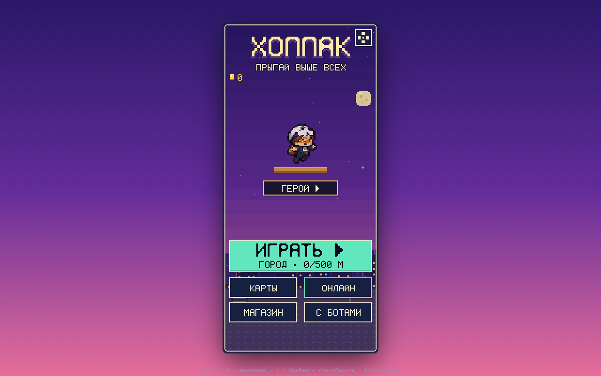
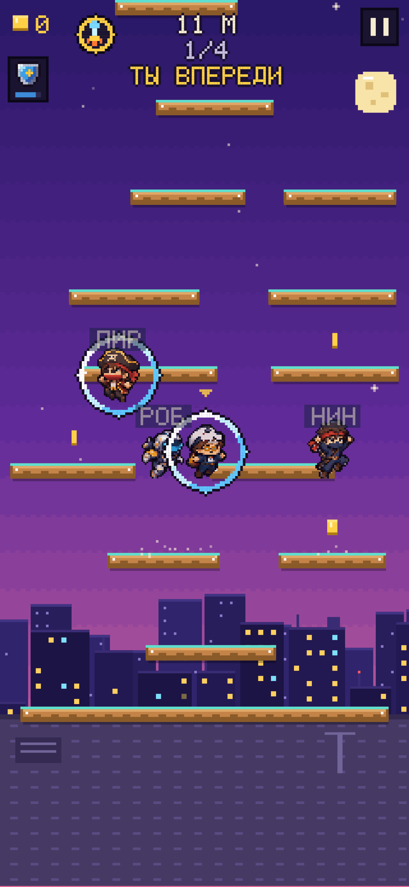
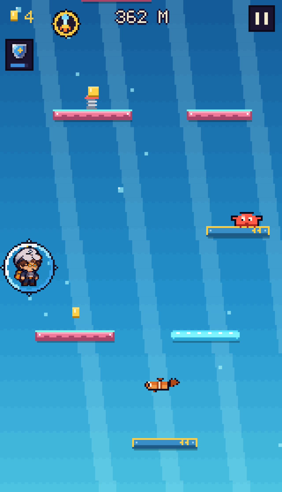
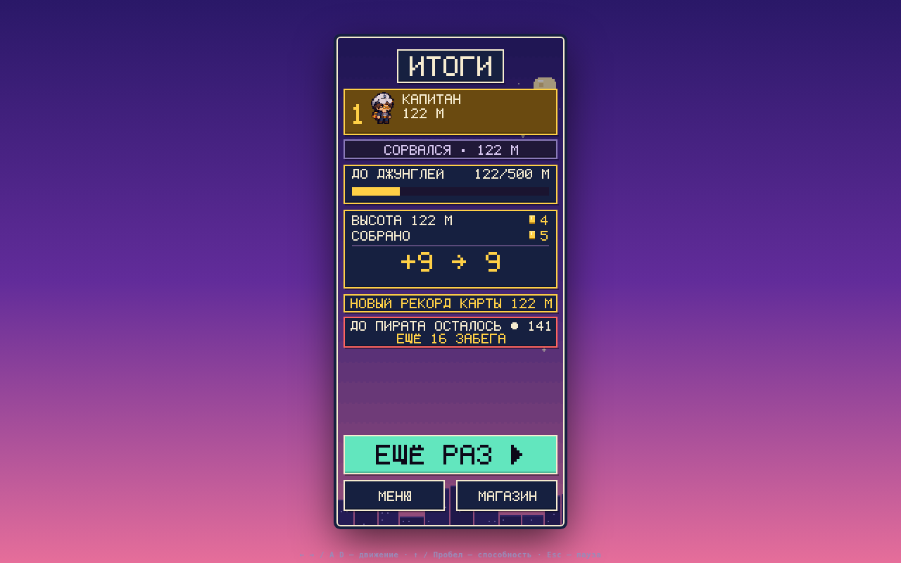

# Хоппак

**Прыгай выше всех**

Пиксельный веб-джампер в духе Doodle Jump: прыгай по платформам, собирай монеты и открывай новые карты и героев. Можно играть в одиночку, с ботами или онлайн — до четырёх игроков в одной комнате.

<p align="center">
  <a href="https://76-13-250-251.sslip.io/"><strong>▶ Играть</strong></a>
</p>

<p align="center">
  
</p>
<p align="center">
  
  
</p>
<p align="center">
  
</p>

## Что есть в игре

- **Шесть карт:** Город, Джунгли, Ледник, Вулкан, Океан и Космос. Город открыт сразу, остальные покупаются за монеты.
- **Шесть героев** со своими способностями: Капитан (рывок), Пират (крюк), Ниндзя (стены), Робот (космощит), Маг (телепорт) и Рыцарь (таран). Капитан доступен сразу, остальных тоже можно открыть за монеты в магазине.
- **Онлайн-комнаты** на четверых: создаёшь комнату, друзья заходят по коду.
- **Одиночная игра и забег с ботами**, если хочется поиграть без компании.
- **Магазин и монеты:** монеты собираются в забеге и тратятся на карты и героев.

## Версии

Сейчас на сайте стоит **v0.59**. Краткие изменения каждой версии — на [странице версий](https://76-13-250-251.sslip.io/versions), исходники релизов — в [GitHub Releases](https://github.com/LedinRoman/hoppak/releases).

## Технологии

- Клиент: TypeScript, HTML5 Canvas, сборка через esbuild.
- Сервер: NestJS 11 и обычный WebSocket (`ws`). Один процесс отдаёт статику и держит комнаты.

Актуальный код игры — в ветке `client/v059` и в теге `release/v0.59`. Ветка `main` сейчас хранит студийные документы и не совпадает с релизным клиентом.

## Как запустить локально

Нужны `git`, `bash`, `python3`, Node.js и npm. `game/build.sh` ищет esbuild строго по пути `/tmp/esb/node_modules/.bin/esbuild`. Его можно поставить так:

```bash
mkdir -p /tmp/esb && npm install --prefix /tmp/esb esbuild
```

Дальше возьми релизный снимок и собери клиент вместе с сервером:

```bash
git clone https://github.com/LedinRoman/hoppak.git
cd hoppak
git checkout release/v0.59
cd server
npm ci && npm run build && npm run client && npm start
```

Игра откроется на [http://localhost:8787](http://localhost:8787), сокет — по `/ws`.

Только клиент, без онлайна:

```bash
cd game
./build.sh
python3 -m http.server 8080
```

Затем открой [http://localhost:8080](http://localhost:8080).

## План

- **0.6** — профиль, вход через Telegram, новые звуки и музыка
- **0.7** — ежедневные задания, трата монет, энциклопедия
- **0.8** — лиги ELO
- **1.0**

