# Хоппак 0.6

В репозитории нет `release.sh`. Когда он появится, текст этой версии брать отсюда: `game/CHANGELOG-0.6.md`.

Сборка `release/v0.6rc`. Физика прыжка, пружины и управление не менялись. Протокол сети остаётся 1: новое событие ломающейся платформы старые клиенты просто не понимают, а в одну комнату они с 0.6 больше не попадают.

## Исправления багов

- Прыжок звучал в момент касания платформы. Теперь звук берётся в отрыве, когда герой получает скорость вверх.
- Счётчик монет прыгал между меню и магазином. Он закреплён справа сверху на всех экранах, кроме счётчика монет забега.
- На карточке героя была вторая жёлтая строка с ролью. Остались имя на плашке и описание.
- Тап по открытой карте открывал окно «ИГРАТЬ». Теперь тап только подсвечивает карту, старт остаётся на главном экране.
- Чужой герой в сети рисовался так же плотно, как свой. Чужие рисуются с прозрачностью 0.8.
- Комнаты собирали любые клиенты. Сервер пускает в комнату только одинаковую версию поколения. Клиент без версии (0.59) по-прежнему играет с такими же. Чужой версии показывается экран «ОБНОВИ СТРАНИЦУ».
- Щит бонуса при включении и когда он спасает не имел звука. Оба момента играют `shield`.
- Часовой лимит монет, потолок 200 за забег и пауза 8 с между финишами сняты. Высота платит `floor(метры / 25)` только с 100 м; ниже в итогах строка «ЗА ВЫСОТУ · С 100 М». Потолки правдоподобия: высота 20000 м, монеты карты 15801, бонус 2500 (потолок генератора, не режет честный забег). Повтор забега, срез и «НЕТ СЕТИ» пишутся в итогах, а не молчаливым +0.
- На iOS в Telegram прыжок иногда молчал: три `HTMLAudioElement` перематывались через `currentTime = 0`, и WebView это проглатывает. Каждый звук теперь новый `AudioBufferSourceNode`. Прыжок не выбрасывается, если слоты заняты. Контекст возобновляется на касании и когда вкладка снова видна.
- Прозрачность чужих не красила ботов. Теперь она на всех, кроме своего героя. Значение фиксировано: 0.84. Строка «ЧУЖИЕ» убрана.
- На iPhone (Safari и Telegram Mini App) ползунки «МУЗЫКА» и «ЗВУКИ» не меняли громкость: музыка шла через `HTMLAudioElement.volume`, а iOS это игнорирует. На ПК тот же ползунок уже работал. Теперь один «ГРОМКОСТЬ» и один «ВКЛ», в настройках и в паузе, одно значение. Музыка и звуки идут через общий `GainNode`: музыка — `decodeAudioData` и петля `AudioBufferSourceNode`. Контекст возобновляется на первом касании и когда вкладка снова видна. Ноль — тишина. Старые два значения складываются в максимум.
- Выход в меню из паузы не записывал рекорд. Теперь это тот же расчёт, что у финиша: рекорд карты, рекорд профиля и монеты по обычным правилам. Повторной выплаты нет.

## Новое и улучшения

- Профиль гостя, вход через Telegram Mini App и слияние гостя в уже существующего игрока. Первый гость переносит до 8000 монет один раз. При слиянии в уже существующий Telegram-профиль монеты не складываются: остаётся серверный баланс. Покупки объединяются, рекорд — максимум из двух.
- Значок «ТГ» и имя из Telegram. Латинские буквы дорисованы в том же шрифте 5×7.
- Подсказка способности один раз за первую игру. Готовая способность — зелёное кольцо, без слова «ГОТОВ».
- Музыка: петля Hush Hamlet (Zane Little, CC0) после первого касания. Громкость «МУЗЫКА» и «ЗВУКИ» с выключением, обе пишутся в сохранение. Таблица `MUSIC_CUES` задаёт трек для экрана и карты.
- Красная платформа в сети ломается у всех: состояние держит сервер и возвращает платформу через 2,5 с.
- Перезарядка: Капитан 8 с, Крюк 8 с, Маг 5 монет, Рыцарь 1 моб. Робот без изменений.
- Космощит робота стал ярче и фиолетовым, чтобы не сливаться с голубым щитом-бонусом: вспышка, кольца, искры, мигание перед концом.
- Кнопка «НАСТРОЙКИ» стоит в сетке меню. В окне — музыка, звуки и, на staging, переключатель «ЧУЖИЕ».
- «ОНЛАЙН» теперь называется «МУЛЬТИПЛЕЕР». Хост комнаты добавляет бота на свободное место и выгоняет игрока или бота. Боты бегут тем же кодом, что «С ботами», и их считает клиент хоста: сервер только пересылает положение. Выгнанный человек видит «ТЕБЯ ВЫГНАЛИ», возвращается в меню и в этой вкладке не входит в ту же комнату. Токен возврата сервер стирает. Протокол сети остаётся 1.

Меню: «С БОТАМИ» убрано, сетка 2×2. До и после, 428×745:

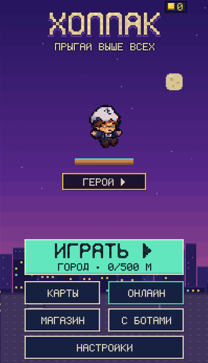

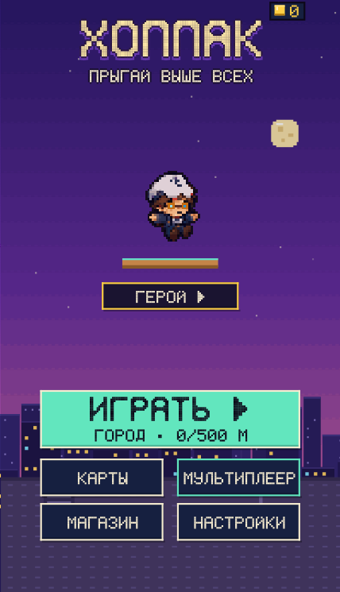

Короткий экран 428×600:

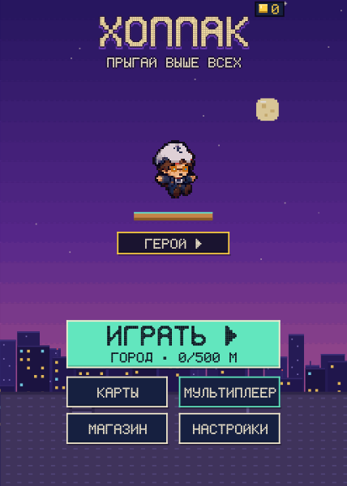

Комната хоста, боты и крестик:

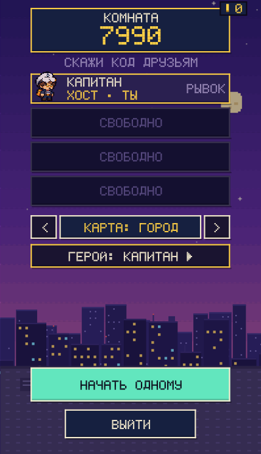

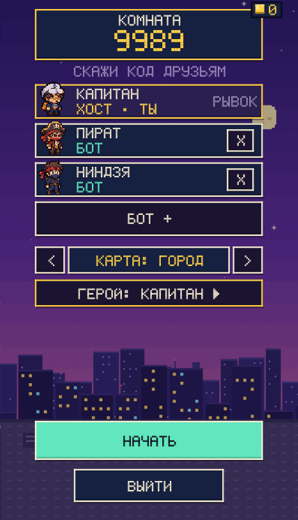

До и после кнопки настроек из прошлого захода, 428×745:

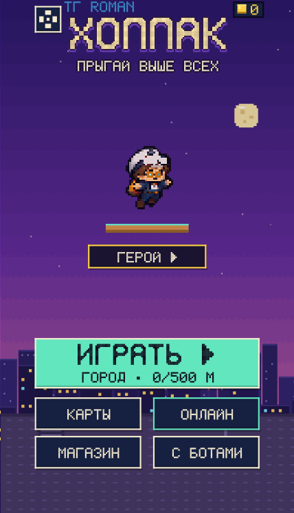

Короткий экран 428×600, кнопка не наезжает на сетку:

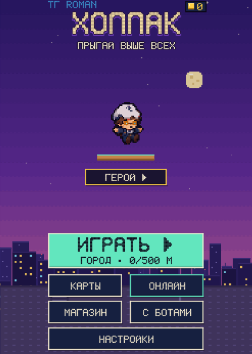

Космощит:

Вспышка в момент включения:

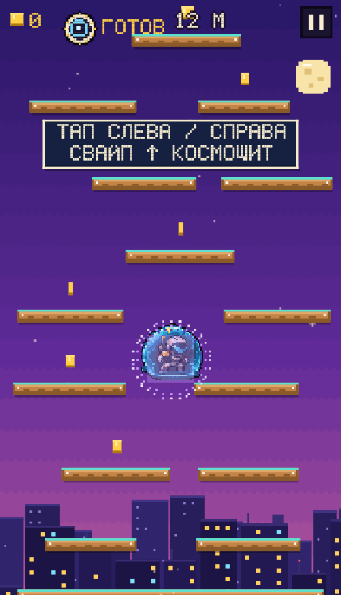

Подсказка способности:

Чужой герой прозрачнее своего:

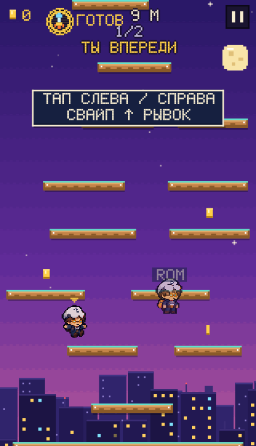

## HUD забега

Слово «ГОТОВ» убрано. Кольцо способности зелёное (`#3a6848`, трава), когда заряд полон, и голубое на кулдауне. Монеты слева, метры справа у паузы, счёт и лидер одной строкой ниже. Верх сдвигается на вырез и шапку Telegram, если они есть. Пауза и столбик мест прижаты к правому краю с тем же отступом 5 px, что у монет слева, плюс правый safe area.

До, способность готова, 390×844 и 428×926:

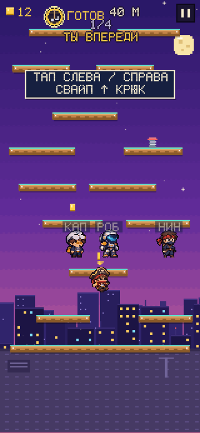

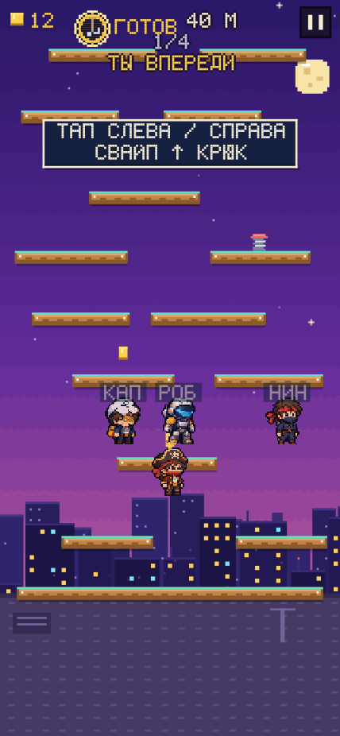

После, готова и на кулдауне:

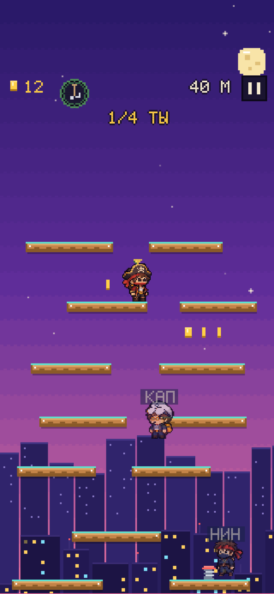

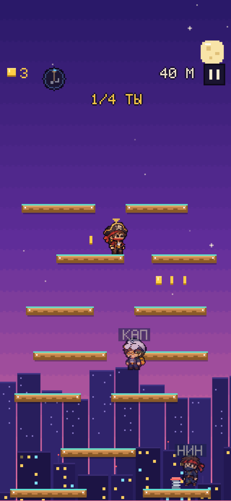

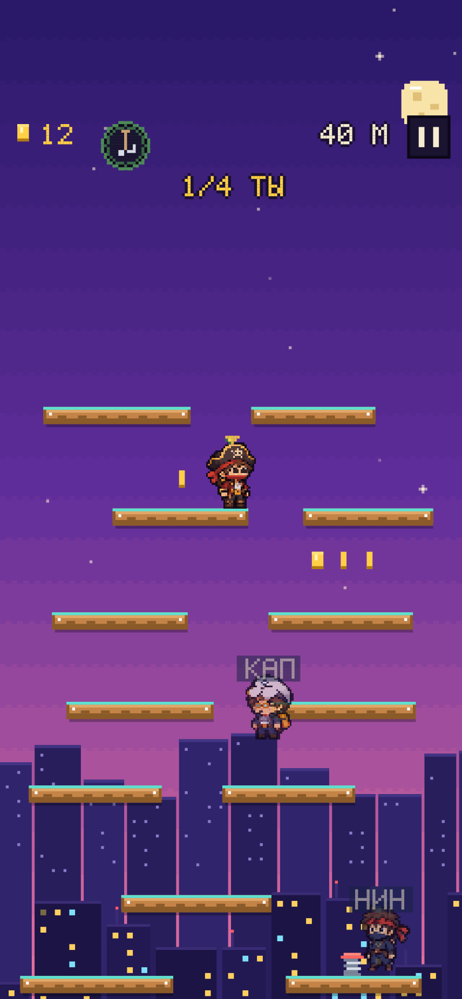

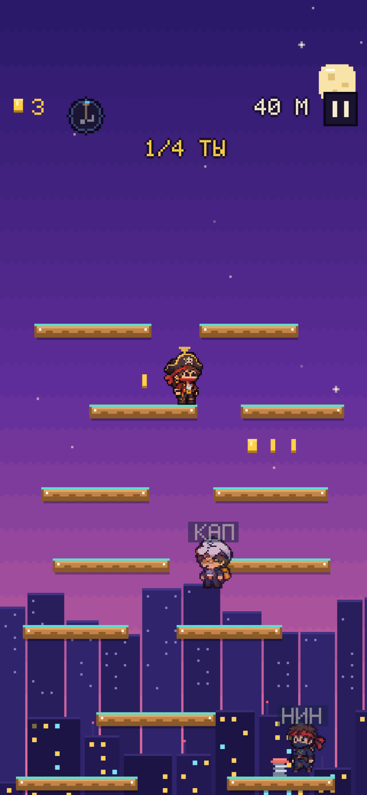

## Места в забеге

Строка «1/4 ТЫ» убрана. В отряде справа под паузой — столбик голов из тех же спрайтов, 12×12, тот же размер пикселя. Лидер сверху. Своя голова в золотой рамке. Выбывший остаётся в столбике, приглушён, с крестом `#a84848`. При обгоне иконки меняются местами плавно, только на отрисовке. В одиночном забеге столбика нет.

До, 390×844 и 428×926, четверо, один выбыл:

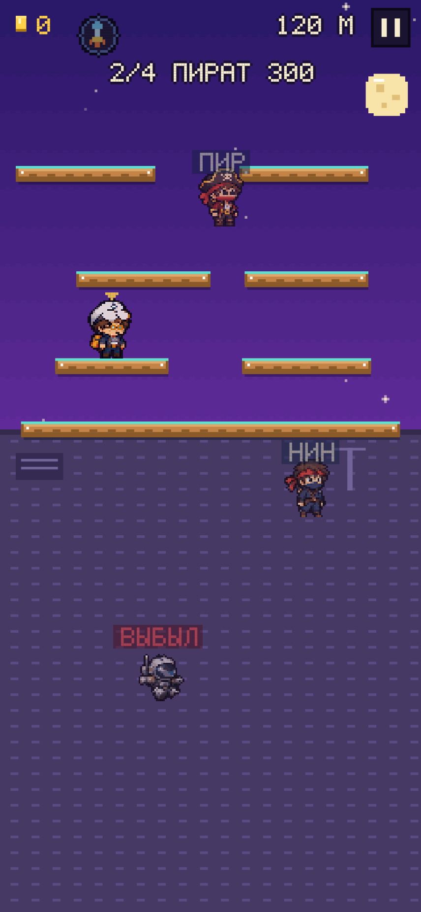

После:

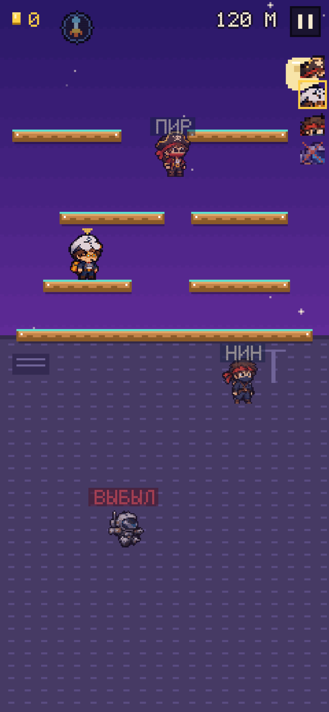

## Аккаунт в полосе монет

«ТГ ИМЯ» убрано. Слева, напротив монет, чип 15×15: у Telegram фото из центральных 70%, усреднённое и собранное в 12 цветов без шума, у гостя силуэт и крошечный «!» `#a89068`. Ник — тот же шрифт 5×7, что и остальной интерфейс, масштаб 1. Длинное имя обрезается точками и не заезжает на монеты. Заливка `#b8ae9a`, контур `#1a1030`. Гость в полосе — `HOP-XXXX`, на карточке — `GUEST HOPPER-XXXX`. Тап открывает «ПРОФИЛЬ». В настройках та же карточка строкой «ПРОФИЛЬ». В забеге чипа нет. Верх меню и забега садится ниже суммы `safeAreaInset` и `contentSafeAreaInset`. Логотип «ХОППАК» и строка «ПРЫГАЙ ВЫШЕ ВСЕХ» стоят ниже чипа и монет, зазор не меньше 4 px. На низком экране логотип уменьшается целым масштабом 2.

До, 390×844, Telegram и гость:

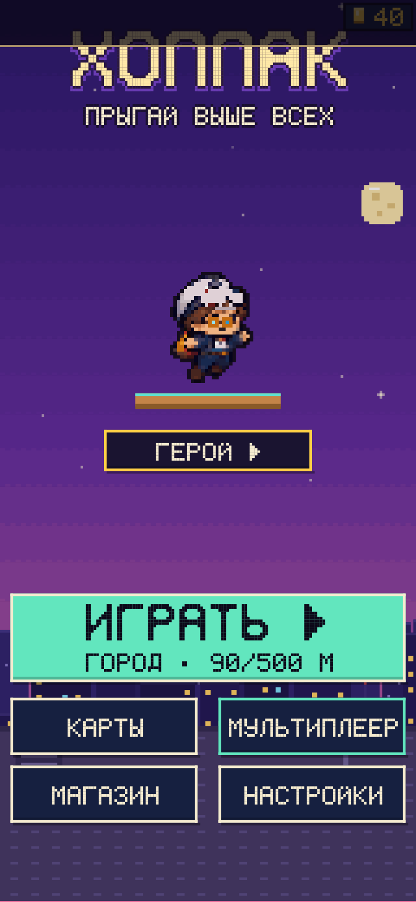

После, меню и карточка, 390×844, и верх на 360×640:

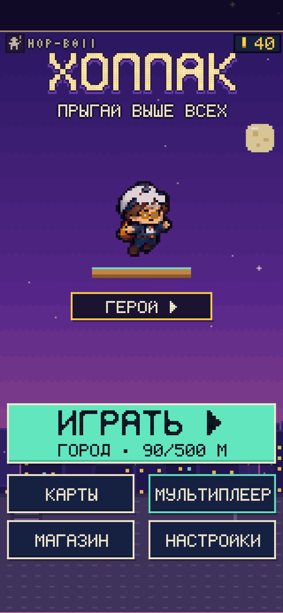

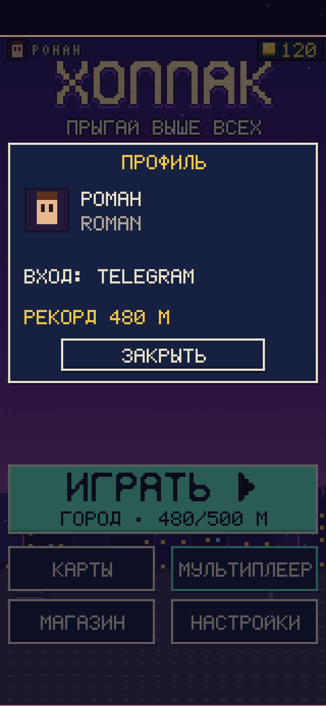

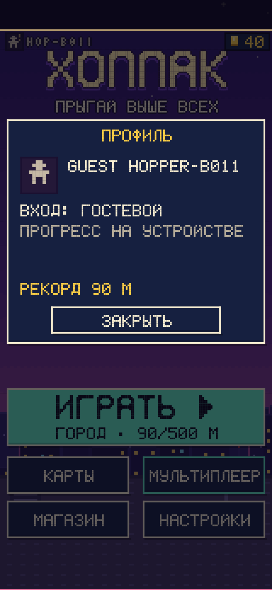

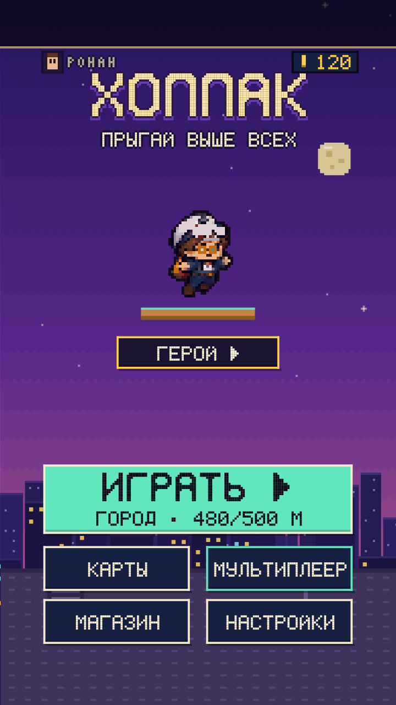

## Щит и склонения

Космощит с первого кадра — сплошное фиолетовое кольцо (тёмный контур `#2a1048`, светлая середина `#f4e8ff`), без бирюзового спрайта и без пунктира. В конце щит по-прежнему мигает. Сила щита не менялась.

Заряд рыцаря: «1 МОБ», не «1 МОБА». Число с существительным склоняется: 1 МОБ / 2 МОБА / 5 МОБОВ, так же МОНЕТА и ЗАБЕГ.

До, город, первый кадр и середина:

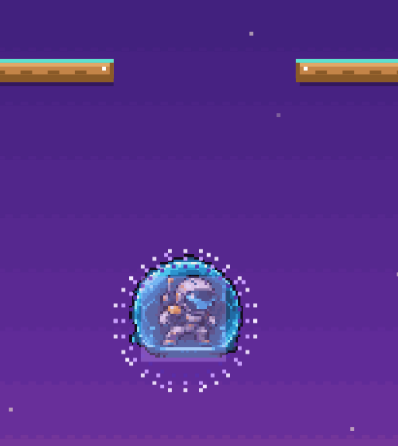

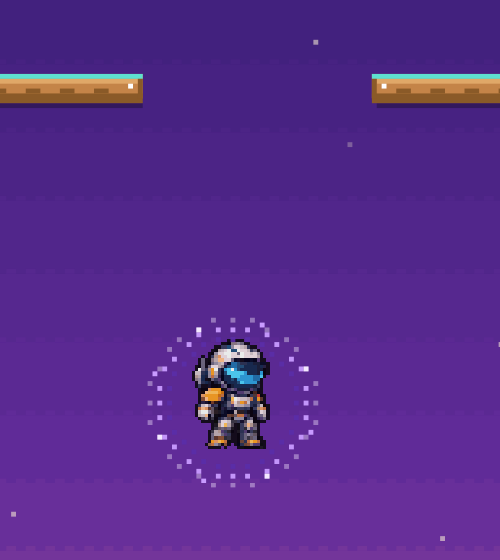

После, город (первый кадр, середина, мигание), джунгли и космос:

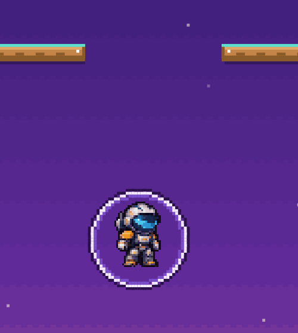

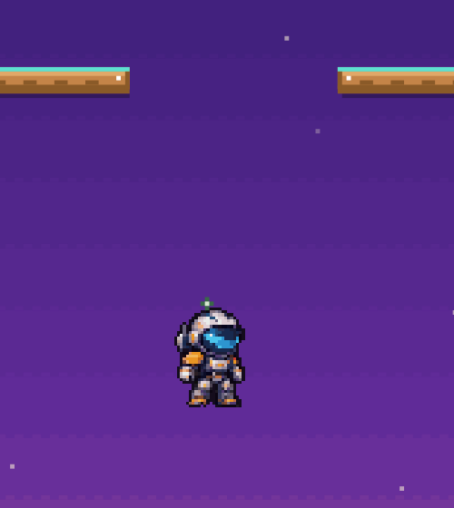

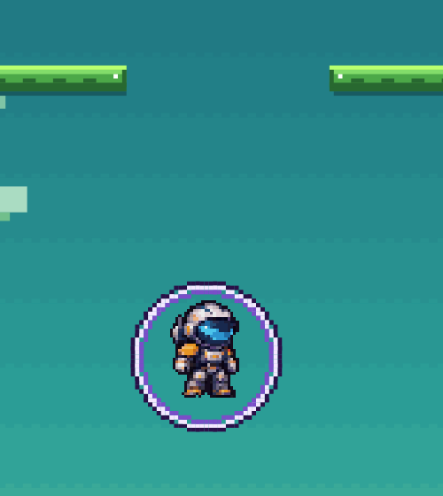

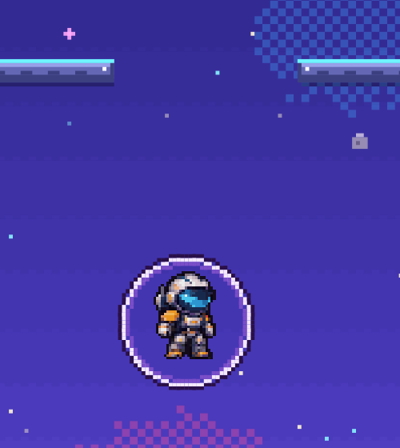

## Мелкие правки

- Имя Telegram стоит слева сверху, монеты остаются справа и не сдвигаются.
- Итоги на экране с шапкой Telegram уплотняются: короткие плашки мест, кнопки выше домашнего индикатора, рекорд не уходит под «РЕВАНШ».
- На широком экране поле стояло масштабом 1 по центру (~170×370). Клавиша F и кнопка в правом верхнем углу включают «кино»: поле на всю высоту окна, по бокам чёрный фон, пропорции и логическое разрешение те же. Если целое число не заполняет высоту, масштаб дробный, пиксели остаются резкими. Esc выходит. В Telegram Mini App и на `(pointer: coarse)` кнопки нет.
- Рекорды карт и открытия жили только в localStorage, поэтому ПК и телефон одного Telegram-профиля расходились. Теперь они в колонке `campaign` профиля. На старте локальный прогресс дописывается максимумом, монеты не прибавляются. Живой забег, в том числе выход из паузы и сеть, пишет рекорд той же карты через `run/finish`.
- `telegram-web-app.js` подключается только в staging-странице `/v/0.6rc/`, асинхронно: медленный telegram.org больше не задерживает первый кадр, вход ждёт готовности SDK (до 4 с).
- Источники звуков перечислены в `game/audio/CREDITS.md`. Все CC0.

## Потом

- Звук пружины. Сейчас отскок от пружины молчит.
