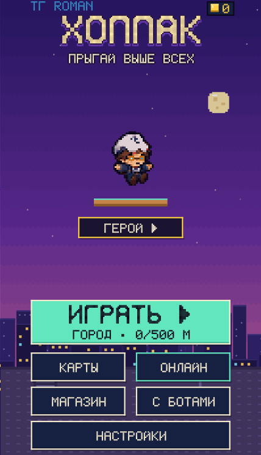
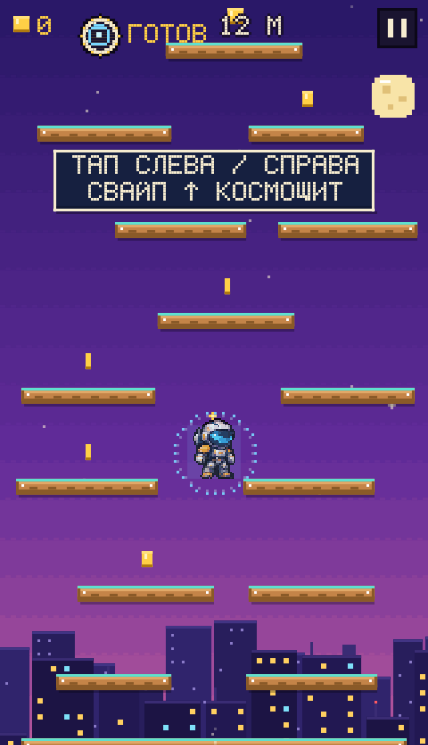
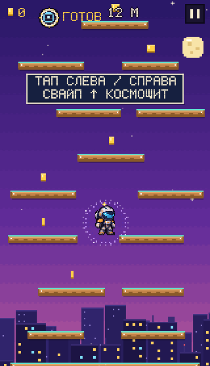
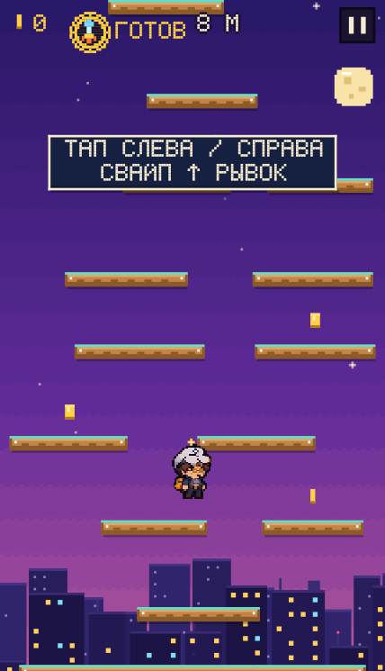

# Хоппак 0.6

В репозитории нет `release.sh`. Когда он появится, текст этой версии брать отсюда: `game/CHANGELOG-0.6.md`.

Сборка `release/v0.6rc`. Физика прыжка, пружины и управление не менялись. Протокол сети остаётся 1: новое событие ломающейся платформы старые клиенты просто не понимают, а в одну комнату они с 0.6 больше не попадают.

## Исправления багов

- Прыжок звучал в момент касания платформы. Теперь звук берётся в отрыве, когда герой получает скорость вверх.
- Счётчик монет прыгал между меню и магазином. Он закреплён справа сверху на всех экранах, кроме счётчика монет забега.
- На карточке героя была вторая жёлтая строка с ролью. Остались имя на плашке и описание.
- Тап по открытой карте открывал окно «ИГРАТЬ». Теперь тап только подсвечивает карту, старт остаётся на главном экране.
- Чужой герой в сети рисовался так же плотно, как свой. Чужие рисуются с прозрачностью 0.8.
- Комнаты собирали любые клиенты. Сервер пускает в комнату только одинаковую версию поколения. Клиент без версии (0.59) по-прежнему играет с такими же. Чужой версии показывается экран «ОБНОВИ СТРАНИЦУ».
- Щит бонуса при включении и когда он спасает не имел звука. Оба момента играют `shield`.

## Новое и улучшения

- Профиль гостя, вход через Telegram Mini App и слияние гостя в уже существующего игрока. В копилку гостя входит не больше 8000 монет, баланс Telegram не режется. Покупки объединяются, рекорд — максимум из двух.
- Значок «ТГ» и имя из Telegram. Латинские буквы дорисованы в том же шрифте 5×7.
- Подсказка способности один раз за первую игру и метка «ГОТОВ», когда способность заряжена.
- Музыка: петля Hush Hamlet (Zane Little, CC0) после первого касания. Громкость «МУЗЫКА» и «ЗВУКИ» с выключением, обе пишутся в сохранение. Таблица `MUSIC_CUES` задаёт трек для экрана и карты.
- Красная платформа в сети ломается у всех: состояние держит сервер и возвращает платформу через 2,5 с.
- Перезарядка: Капитан 8 с, Крюк 8 с, Маг 5 монет, Рыцарь 1 моб. Робот без изменений.
- Космощит робота стал ярче и фиолетовым, чтобы не сливаться с голубым щитом-бонусом: вспышка, кольца, искры, мигание перед концом.
- Кнопка «НАСТРОЙКИ» стоит в сетке меню. В окне — музыка, звуки и, на staging, переключатель «ЧУЖИЕ».
- «ОНЛАЙН» теперь называется «МУЛЬТИПЛЕЕР». Хост комнаты добавляет бота на свободное место и выгоняет игрока или бота. Боты бегут тем же кодом, что «С ботами», и их считает клиент хоста: сервер только пересылает положение. Выгнанный человек видит «ТЕБЯ ВЫГНАЛИ», возвращается в меню и в этой вкладке не входит в ту же комнату. Токен возврата сервер стирает. Протокол сети остаётся 1.

Меню: «С БОТАМИ» убрано, сетка 2×2. До и после, 428×745:

Короткий экран 428×600:

Комната хоста, боты и крестик:

До и после кнопки настроек из прошлого захода, 428×745:

Короткий экран 428×600, кнопка не наезжает на сетку:

Космощит:

Вспышка в момент включения:

Подсказка способности и «ГОТОВ»:

Чужой герой прозрачнее своего:

## Мелкие правки

- Имя Telegram стоит слева сверху, монеты остаются справа и не сдвигаются.
- На staging в настройках три ступени прозрачности чужих: 0.7, 0.8, 0.9.
- `telegram-web-app.js` подключается только в staging-странице `/v/0.6rc/`.
- Источники звуков перечислены в `game/audio/CREDITS.md`. Все CC0.
